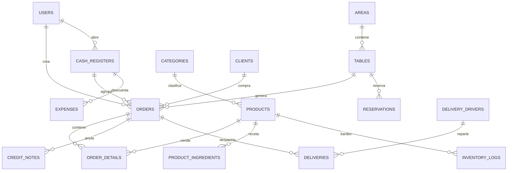

# Diccionario de Base de Datos — Sistema Restaurante
**BD origen:** `restaurante_db` — MySQL 8.4.3 / InnoDB / `utf8mb4_unicode_ci`
**Fuente:** `database/migrations/*.php` (36) + `bk_basededatos.sql` (estructura + datos demo) + `app/Models/*` + `app/Ia/ia.php` (vistas)
**Fecha:** 2026-10-16
**Objetivo:** extrapolar la BD a otro proyecto (esquema limpio, sin datos demo).

---

## 0. Veredicto Multi-Tenant (revisado antes de generar este doc)

**Resultado: NO existe arquitectura multi-tenant. Nada que eliminar.**

Evidencia:
- `grep` en `app/`, `database/`, `config/` para `tenant|tenancy|team_id|company_id|organization_id|business_id|sucursal|branch|store_id` → **0 coincidencias en código de negocio** (solo `branch-alias` en `composer.lock` y READMEs de `node_modules`, irrelevantes).
- Ninguna migración contiene `tenant_id`, `company_id`, `team_id`, `sucursal_id`, ni paquetes `stancl/tenancy`, `spatie/laravel-multitenancy`, scopes globales por tenant.
- Lo único parecido es `settings.key LIKE 'company_%'` (`company_name, company_phone, company_address, sunat_ruc, sunat_razon_social...`), que es **configuración single-empresa** (una sola razón social por instalación, exigida por SUNAT Perú), no multi-tenant.
- `users.role` (admin/cashier/waiter/kitchen) es RBAC simple, no aislamiento por tenant.

**Consecuencia para extrapolación:** el esquema adjunto es **single-tenant limpio**. Si tu nuevo proyecto necesita multi-tenant, debes añadirlo (ver §10).

---

## 1. Cómo reutilizar en otro proyecto

Opción A (recomendada Laravel): copiar `database/migrations/*.php` + crear `ia_consultas` + vistas `v_ia_*` (ver §8), luego `php artisan migrate`.
Opción B (SQL puro): crear BD vacía y ejecutar solo los `CREATE TABLE` de §3 en el orden de §9, luego `CREATE VIEW` de §8. **No ejecutes los `INSERT`/`DELETE FROM` de `bk_basededatos.sql`** (son demo).

```sql
CREATE DATABASE IF NOT EXISTS restaurante_db
  DEFAULT CHARACTER SET utf8mb4 COLLATE utf8mb4_unicode_ci;
USE restaurante_db;
```

Convenciones globales:
- Motor `InnoDB`, PK `id BIGINT UNSIGNED AUTO_INCREMENT`, FKs `BIGINT UNSIGNED`.
- `created_at / updated_at TIMESTAMP NULL` (Laravel, nullable en este dump).
- Borrado lógico por bandera `is_active TINYINT(1) DEFAULT 1`, no `deleted_at` (excepto borrado físico en categorías sin productos).
- Dinero: `DECIMAL(10,2)` operativo, `DECIMAL(12,2)` fiscal, `DECIMAL(14,2)` agregados, `DECIMAL(8,2)` delivery_fee.
- `stock INT NULL` → `NULL` = no se controla / ilimitado.
- Enums MySQL para estados (ver cada tabla).

---

## 2. Inventario

**27 tablas físicas** (22 negocio + 5 sistema/aux):

Negocio: `areas, tables, categories, products, product_ingredients, reservations, clients, orders, order_details, cash_registers, expenses, inventory_logs, delivery_drivers, deliveries, users, settings, document_series, credit_notes, daily_summaries, ia_consultas`
Sistema Laravel: `cache, cache_locks, jobs, job_batches, failed_jobs, sessions, migrations`
**11 vistas lectura IA:** `v_ia_cajas, v_ia_categorias, v_ia_clientes, v_ia_deliveries, v_ia_detalle_ventas, v_ia_gastos, v_ia_mesas, v_ia_movimientos_inventario, v_ia_productos, v_ia_reservas, v_ia_ventas`

---

## 3. Detalle tabla por tabla (para extrapolar)

### 3.1 `users`
| Col | Tipo MySQL | Nulo | Default | Índice |
|---|---|---|---|---|
| id | BIGINT UNSIGNED AI | NO | — | PK |
| name | VARCHAR(255) | NO | — | — |
| email | VARCHAR(255) | NO | — | UNIQUE |
| email_verified_at | TIMESTAMP | SÍ | NULL | — |
| password | VARCHAR(255) | NO | — | — |
| role | ENUM('admin','cashier','waiter','kitchen') | NO | 'admin' | — |
| remember_token | VARCHAR(100) | SÍ | NULL | — |
| created_at, updated_at | TIMESTAMP | SÍ | NULL | — |
Padre de: orders, cash_registers, expenses, inventory_logs, deliveries, credit_notes(SET NULL), daily_summaries(SET NULL). Sin FKs.

### 3.2 `areas`
| id BIGINT UNSIGNED AI PK | name VARCHAR(255) NOT NULL | created_at/updated_at TIMESTAMP NULL |
Padre de `tables`.

### 3.3 `tables` (mesas + plano)
| Col | Tipo | Nulo/Default |
|---|---|---|
| id | BIGINT UNSIGNED AI PK | — |
| area_id | BIGINT UNSIGNED NOT NULL | FK→areas.id CASCADE |
| name | VARCHAR(255) NOT NULL | — |
| seats | INT NOT NULL | DEFAULT 4 |
| status | ENUM('available','occupied','reserved') NOT NULL | DEFAULT 'available' |
| x_pos, y_pos | INT NOT NULL | DEFAULT 0 |
| created_at/updated_at | TIMESTAMP NULL | — |

### 3.4 `categories`
| id PK | name VARCHAR(255) NOT NULL | image VARCHAR(255) NULL | is_active TINYINT(1) NOT NULL DEFAULT 1 | timestamps NULL |

### 3.5 `products`
| Col | Tipo | Nulo/Default | Notas |
|---|---|---|---|
| id | BIGINT UNSIGNED AI PK | — | — |
| category_id | BIGINT UNSIGNED NOT NULL | FK→categories.id CASCADE | — |
| name | VARCHAR(255) NOT NULL | — | — |
| code | VARCHAR(255) NULL | — | código interno (no está en fillable, pero sí en BD/vista) |
| barcode | VARCHAR(255) NULL | UNIQUE | escáner POS |
| price | DECIMAL(10,2) NOT NULL | — | venta |
| promotional_price | DECIMAL(10,2) NULL | — | carta QR |
| cost | DECIMAL(10,2) NULL | — | si tiene receta se calcula |
| stock | INT NULL | — | NULL=ilimitado |
| is_saleable | TINYINT(1) NOT NULL DEFAULT 1 | — | 0=insumo puro |
| image | VARCHAR(255) NULL | — | `storage/products` |
| is_active | TINYINT(1) DEFAULT 1 | — | — |
| is_chef_recommendation, is_new | TINYINT(1) DEFAULT 0 | — | badges carta |
| timestamps | TIMESTAMP NULL | — | — |

### 3.6 `product_ingredients` (receta / pivote, sin modelo)
| id PK | product_id BIGINT UNSIGNED NOT NULL FK→products.id CASCADE (plato) | ingredient_id BIGINT UNSIGNED NOT NULL FK→products.id CASCADE (insumo) | quantity DECIMAL(10,2) NOT NULL | timestamps NULL |

### 3.7 `reservations`
| id PK | client_name VARCHAR(255) NOT NULL | phone VARCHAR(255) NULL | reservation_time DATETIME NOT NULL | people INT NOT NULL | table_id BIGINT UNSIGNED NULL FK→tables.id SET NULL | note TEXT NULL | status ENUM('pending','confirmed','cancelled') DEFAULT 'pending' | timestamps NULL |

### 3.8 `clients`
| id PK | name VARCHAR(255) NOT NULL | document_type VARCHAR(255) NOT NULL DEFAULT 'DNI' | document_number VARCHAR(255) NULL UNIQUE | email/phone/address VARCHAR(255) NULL | timestamps NULL |
> Nota: `Client::$fillable` omite `document_type` e incluye `notes` inexistente → al extrapolar, usa el DDL (corrige fillable en nuevo proyecto).

### 3.9 `orders` (cabecera venta — tabla central)
| Grupo | Col | Tipo / Default |
|---|---|---|
| PK | id BIGINT UNSIGNED AI | PK |
| FK | table_id BIGINT UNSIGNED NULL →tables.id (RESTRICT) | NULL=delivery/mostrador |
| FK | user_id BIGINT UNSIGNED NOT NULL →users.id | creador |
| FK | client_id BIGINT UNSIGNED NULL →clients.id SET NULL | — |
| FK | cash_register_id BIGINT UNSIGNED NULL →cash_registers.id SET NULL | turno |
| estado | status ENUM('pending','completed','cancelled') DEFAULT 'pending' | — |
| totales | total DECIMAL(10,2) DEFAULT 0; subtotal/igv/total_gravada/exonerada/inafecta/gratuita DECIMAL(12,2) DEFAULT 0 | desglose SUNAT |
| cobro | discount DECIMAL(10,2) DEFAULT 0; tip DECIMAL(10,2) DEFAULT 0; payment_method VARCHAR DEFAULT 'cash'; received_amount DECIMAL(10,2) NULL; change_amount DECIMAL(10,2) DEFAULT 0 | — |
| doc | document_type VARCHAR DEFAULT 'Ticket'; client_name VARCHAR DEFAULT 'Público General'; client_document VARCHAR NULL; serie VARCHAR(4) NULL; correlativo INT UNSIGNED NULL; UNIQUE(document_type,serie,correlativo) | — |
| SUNAT | sunat_status VARCHAR(30) DEFAULT 'PENDING'; sunat_code VARCHAR(10) NULL; sunat_description TEXT NULL; xml_path/cdr_path/pdf_path VARCHAR NULL; hash VARCHAR(100) NULL; sent_at TIMESTAMP NULL | — |
| aux | notes TEXT NULL; timestamps NULL | — |

### 3.10 `order_details`
| id PK | order_id BIGINT UNSIGNED NOT NULL FK→orders.id CASCADE | product_id BIGINT UNSIGNED NOT NULL FK→products.id | quantity INT DEFAULT 1 | price DECIMAL(10,2) NOT NULL (congelado) | note VARCHAR NULL | status ENUM('pending','cooking','served') DEFAULT 'pending' | timestamps NULL |

### 3.11 `cash_registers` (turnos)
| id PK | user_id BIGINT UNSIGNED NOT NULL FK→users.id CASCADE | opening_time DATETIME NOT NULL | closing_time DATETIME NULL | opening_amount DECIMAL(10,2) NOT NULL | closing_amount/expected_amount/difference DECIMAL(10,2) NULL | status ENUM('open','closed') DEFAULT 'open' | notes TEXT NULL | timestamps NULL |

### 3.12 `expenses`
| id PK | description VARCHAR(255) NOT NULL | amount DECIMAL(10,2) NOT NULL | user_id BIGINT UNSIGNED NOT NULL FK→users.id | cash_register_id BIGINT UNSIGNED NULL FK→cash_registers.id SET NULL | timestamps NULL |

### 3.13 `inventory_logs` (kardex)
| id PK | product_id BIGINT UNSIGNED NOT NULL FK→products.id CASCADE | user_id BIGINT UNSIGNED NOT NULL FK→users.id | type VARCHAR NOT NULL (sale/purchase/adjustment) | quantity INT NOT NULL (negativo=salida) | old_stock/new_stock INT NULL | note VARCHAR NULL | timestamps NULL |

### 3.14 `delivery_drivers`
| id PK | name VARCHAR(255) NOT NULL | phone VARCHAR(255) NULL | is_active TINYINT(1) DEFAULT 1 | timestamps NULL |

### 3.15 `deliveries`
| id PK | order_id BIGINT UNSIGNED NOT NULL FK→orders.id CASCADE | client_id BIGINT UNSIGNED NULL FK→clients.id SET NULL | client_name/client_phone VARCHAR NOT NULL (snapshot) | address TEXT NOT NULL | reference VARCHAR NULL | driver_id BIGINT UNSIGNED NULL FK→delivery_drivers.id SET NULL | user_id BIGINT UNSIGNED NOT NULL FK→users.id | cash_register_id BIGINT UNSIGNED NULL FK→cash_registers.id SET NULL | status ENUM('pending','preparing','on_way','delivered','cancelled') DEFAULT 'pending' | payment_method ENUM('cash','card','transfer') DEFAULT 'cash' | delivery_fee DECIMAL(8,2) DEFAULT 0 | notes TEXT NULL | scheduled_at/delivered_at TIMESTAMP NULL | timestamps NULL |

### 3.16 `settings` (clave-valor empresa + SUNAT)
| id PK | key VARCHAR UNIQUE NOT NULL | value TEXT NULL | timestamps NULL |
Claves esperadas: `company_name, company_phone, company_address, company_logo, timezone, currency_symbol, ticket_footer, sunat_ruc(11), sunat_razon_social, sunat_nombre_comercial, sunat_direccion_fiscal, sunat_ubigeo, sunat_departamento/provincia/distrito/urbanizacion, sunat_environment(beta|produccion), sunat_igv_rate(18), sunat_sol_user/pass, sunat_cert_password` (+ archivo cert en disco `sunat/certs/`).

### 3.17 `document_series` (talonarios)
| id PK | document_code VARCHAR(2) NOT NULL (01/03/07/08) | document_type VARCHAR(30) NOT NULL (factura/boleta/nota_credito_boleta/nota_credito_factura) | serie VARCHAR(4) NOT NULL UNIQUE (B001/F001/BC01/FC01) | last_number INT UNSIGNED DEFAULT 0 | is_active TINYINT(1) DEFAULT 1 | timestamps NULL |
Seed: (03,boleta,B001), (01,factura,F001), (07,nota_credito_boleta,BC01), (07,nota_credito_factura,FC01).

### 3.18 `credit_notes`
| id PK | order_id BIGINT UNSIGNED NOT NULL FK→orders.id CASCADE | serie VARCHAR(4) NOT NULL | correlativo INT UNSIGNED NOT NULL | UNIQUE(serie,correlativo) | document_type VARCHAR(30) DEFAULT 'nota_credito' | reason_code VARCHAR(2) NOT NULL (Cat.09: 01/02/03/06/07/13) | reason_description VARCHAR NOT NULL | subtotal/igv/total DECIMAL(12,2) DEFAULT 0 | sunat_status/code/description/xml/cdr/pdf/hash/sent_at (igual que orders) | user_id BIGINT UNSIGNED NULL FK→users.id SET NULL | timestamps NULL |

### 3.19 `daily_summaries` (RC boletas)
| id PK | reference_date DATE NOT NULL | generation_date DATE NOT NULL | correlativo INT UNSIGNED NOT NULL | UNIQUE(reference_date,correlativo) | identifier VARCHAR(30) NOT NULL (RC-yyyymmdd-N) | total_documents INT UNSIGNED DEFAULT 0 | total_amount DECIMAL(14,2) DEFAULT 0 | sunat_status VARCHAR(30) DEFAULT 'PENDING' | ticket VARCHAR(100) NULL | sunat_code/description/xml/cdr/hash/sent_at + consulted_at TIMESTAMP NULL | user_id BIGINT UNSIGNED NULL FK→users.id SET NULL | timestamps NULL |

### 3.20 `ia_consultas` (NO tiene migración — creada por `app/Ia/ia.php::ia_asegurar()`)
```sql
CREATE TABLE IF NOT EXISTS ia_consultas (
  id INT AUTO_INCREMENT PRIMARY KEY,
  usuario_id BIGINT NOT NULL,
  pregunta VARCHAR(500) NOT NULL,
  titulo VARCHAR(160) NULL,
  sql_texto TEXT NOT NULL,
  grafico VARCHAR(255) NULL,
  favorito TINYINT(1) NOT NULL DEFAULT 0,
  veces INT NOT NULL DEFAULT 1,
  creado_en DATETIME DEFAULT CURRENT_TIMESTAMP,
  ultimo_uso DATETIME DEFAULT CURRENT_TIMESTAMP,
  INDEX (usuario_id, favorito)
) ENGINE=InnoDB DEFAULT CHARSET=utf8mb4;
```
Sin FK formal (usuario_id → users.id lógico).

### 3.21 Tablas sistema Laravel (copiar tal cual si usas Laravel)
`cache(key PK, value MEDIUMTEXT, expiration INT)`, `cache_locks(key PK, owner, expiration)`, `jobs, job_batches, failed_jobs, sessions(id PK, user_id NULL sin FK, ip, user_agent, payload LONGTEXT, last_activity INT), migrations`.

---

## 4. FKs y cardinalidad (resumen para ER)

```
users 1──<N orders, cash_registers, expenses, inventory_logs, deliveries, credit_notes, daily_summaries
categories 1──<N products (CASCADE)
products 1──<N order_details + inventory_logs (CASCADE) | N<──>N products vía product_ingredients (doble CASCADE)
areas 1──<N tables (CASCADE)
tables 1──<N orders (nullable) + reservations (SET NULL)
clients 1──<N orders + deliveries (SET NULL)
cash_registers 1──<N orders + expenses + deliveries (SET NULL)
orders 1──<N order_details + credit_notes (CASCADE) + 1 delivery (CASCADE)
delivery_drivers 1──<N deliveries (SET NULL)
document_series, daily_summaries, settings, ia_consultas: sin FK / solo users
```

Diagrama Mermaid (pegar en editor):


---

## 5. Índices y constraints a replicar

- UNIQUE: `users.email`, `products.barcode`, `clients.document_number`, `orders(document_type,serie,correlativo)`, `credit_notes(serie,correlativo)`, `daily_summaries(reference_date,correlativo)`, `document_series.serie`, `settings.key`, `failed_jobs.uuid`.
- INDEX: todas las FKs + `ia_consultas(usuario_id,favorito)`.
- ON DELETE: CASCADE en `products→categories, order_details→orders, credit_notes→orders, deliveries→orders, inventory_logs→products, cash_registers→users, tables→areas, product_ingredients→products(ambas)`; SET NULL en `orders.client_id/cash_register_id, reservations.table_id, expenses.cash_register_id, deliveries.client_id/driver_id/cash_register_id, credit_notes/daily_summaries.user_id`.

---

## 6. Vistas `v_ia_*` (solo lectura, para IA/BI — recrear en nuevo proyecto si quieres el asistente)

Definidas en `bk_basededatos.sql` (bloque final `CREATE VIEW`) y descritas en `app/Ia/ia.php`. Todas `ALGORITHM=UNDEFINED SQL SECURITY DEFINER`:

| Vista | Base | Columnas expuestas |
|---|---|---|
| v_ia_ventas | orders+users+tables+areas | venta_id, fecha, dia, estado(COMPLETADA/PENDIENTE/ANULADA), origen(SALON/DELIVERY), mesa, area, mozo_cajero, cliente, cliente_documento, tipo_comprobante, comprobante(serie-correlativo), subtotal, descuento, propina, impuesto, total, metodo_pago |
| v_ia_detalle_ventas | order_details+orders+products+categories+users | venta_id, fecha, dia, producto_id, producto, categoria, cantidad, precio_unitario, costo_unitario, importe, utilidad, estado_venta, origen, metodo_pago, mozo_cajero |
| v_ia_productos | products+categories | producto_id, codigo, codigo_barras, producto, categoria, precio, precio_promocional, costo, margen_unitario, stock, stock_bajo(≤5), activo, vendible, recomendado_chef, nuevo, creado_en |
| v_ia_categorias | categories | categoria_id, categoria, activa, num_productos |
| v_ia_clientes | clients+orders | cliente_id, nombre, tipo_doc, documento, email, telefono, direccion, creado_en, num_compras, total_comprado, ultima_compra |
| v_ia_gastos | expenses+users | gasto_id, fecha, dia, concepto, monto, usuario |
| v_ia_movimientos_inventario | inventory_logs+products+users | fecha, producto, tipo, cantidad, stock_anterior, stock_resultante, motivo, usuario |
| v_ia_reservas | reservations+tables | reserva_id, cliente, telefono, fecha_hora, dia, personas, mesa, estado, nota |
| v_ia_deliveries | deliveries+drivers | delivery_id, venta_id, fecha, dia, cliente, telefono, direccion, repartidor, estado, metodo_pago, costo_envio, entregado_el |
| v_ia_cajas | cash_registers+users | caja_id, cajero, fecha_apertura/cierre, monto_apertura/cierre/esperado, diferencia, estado(ABIERTA/CERRADA) |
| v_ia_mesas | tables+areas | mesa_id, mesa, area, asientos, estado |

Regla IA: solo `SELECT` sobre estas vistas; ventas válidas = `COMPLETADA`. Ver SQL exacto en `bk_basededatos.sql` (buscar `CREATE ALGORITHM... VIEW v_ia_`).

---

## 7. Qué NO migrar (demo) y qué es específico Perú

- **No migrar datos:** todos los `INSERT` del `.sql` son demo (areas 2, categories 10, clients 30, cash_registers 20, expenses 30, drivers 4, deliveries 21, credit_notes 20, daily_summaries 20, inventory_logs ~993, orders/order_details/products cientos). Solo conserva `document_series` 4 filas como seed.
- **Módulo país-específico (opcional):** `document_series, credit_notes, daily_summaries` + columnas `orders.serie/correlativo/subtotal/igv/*exonerada*/sunat_*` + `settings.sunat_*`. Si el nuevo proyecto no es Perú/SUNAT, puedes omitirlos y dejar `orders.document_type/client_name/total` simple.

---

## 8. Orden de creación (por dependencias)

```
1 users, areas, categories, document_series, settings, ia_consultas
2 tables (→areas), products (→categories), clients
3 product_ingredients (→products x2), cash_registers (→users)
4 reservations (→tables), orders (→tables/users/clients/cash_registers)
5 order_details (→orders/products), expenses (→users/cash_registers)
6 inventory_logs (→products/users), delivery_drivers
7 deliveries (→orders/clients/drivers/users/cash_registers)
8 credit_notes (→orders/users), daily_summaries (→users)
9 sistema: cache, cache_locks, jobs, job_batches, failed_jobs, sessions, migrations
10 vistas v_ia_* (al final, dependen de todo)
```

---

## 9. DDL mínimo portable (encabezado por tabla — completar con §3)

Usa los tipos de §3; ejemplo patrón FK:
```sql
`area_id` BIGINT UNSIGNED NOT NULL,
CONSTRAINT `tables_area_id_foreign` FOREIGN KEY (`area_id`) REFERENCES `areas`(`id`) ON DELETE CASCADE
```
Para el DDL literal completo, extrae de `bk_basededatos.sql` cada bloque `CREATE TABLE IF NOT EXISTS ... ;` en el orden de §8. Charset: `ENGINE=InnoDB DEFAULT CHARSET=utf8mb4 COLLATE=utf8mb4_unicode_ci`.

---

## 10. Si necesitas multi-tenant en el nuevo proyecto (no existe en origen)

Añade a **todas** las tablas de negocio: `tenant_id BIGINT UNSIGNED NOT NULL, INDEX(tenant_id), FK→tenants.id CASCADE` + `UNIQUE` compuestos con `tenant_id` (ej. `UNIQUE(tenant_id,serie,correlativo)` en vez de global), scopes globales Eloquent y `DocumentSeries::next()` filtrado por tenant. Tablas `settings/document_series` también deben ser por-tenant. Esto es diseño nuevo, no viene del sistema actual.

